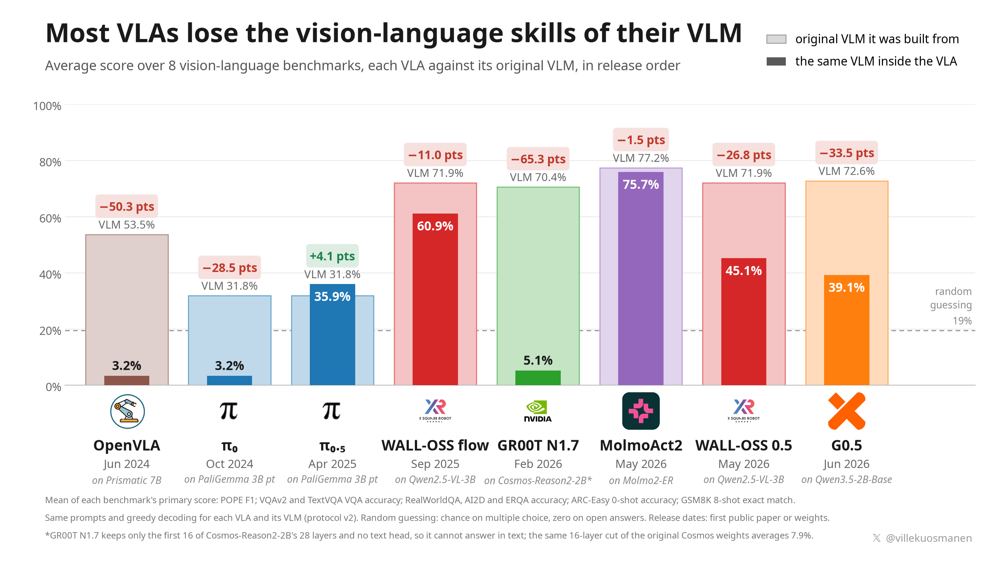

# VLM benchmarks for VLA backbones



Eight VLAs, each scored against the original VLM it was trained from on the
same eight vision-language and text benchmarks. Six of them lose 11 points or
more on average; only π₀.₅ and MolmoAct2 keep their VLM's level. Per-benchmark
scores are in [`results/chart.png`](results/chart.png) and
[`results/summary.json`](results/summary.json), and every prediction is stored
in `results/`.

Score the vision-language backbone inside a pretrained VLA on ordinary,
non-robotic tasks, and compare it with the original VLM that VLA was trained
from. The question is whether action training left that backbone able to
answer questions. It is not a robot-success eval.

A VLA is not scored by prompting its robot template. Several of these policies
have no slot for a free-form question (G0.5 says so explicitly). The loader
copies the backbone tensors onto the original VLM architecture and runs that
VLM's own processor and prompt. Baseline and VLA in one family see the same
pixels, the same question text, and the same score. The action expert, flow
head, and action-token rows are left out of the copy.

The copy has to be complete. If a language, vision, projector, or embedding
tensor is missing or matches two experts, the run stops and writes the key
names. It does not publish a score from a mixture of VLA weights and untouched
baseline weights.

## Run

Use a separate environment. This tree wants a CUDA torch build and a
transformers release that contains PaliGemma, Qwen2.5-VL, Qwen3-VL, and
Qwen3.5. Qwen3.5's linear-attention layers are much faster with
`flash-linear-attention` installed; without it they fall back to a slow
PyTorch kernel.

```bash
git clone https://github.com/villekuosmanen/vla-vlm-benchmarks.git
cd vla-vlm-benchmarks
uv sync
source .venv/bin/activate
hf auth login
```

`uv sync` creates `.venv` in this directory and installs PyTorch there. `uv run pytest`
and `uv run python -m vla_vlm_benchmarks` use that environment. The lockfile
pins the wheels. Re-run `uv lock` after changing `pyproject.toml`.

PaliGemma, Cosmos-Reason2, GR00T, and G0.5 are gated. Accept each license on
its Hub page before the first download. OpenVLA loads its modeling code with
`trust_remote_code`.

```bash
python -m vla_vlm_benchmarks --list
python -m vla_vlm_benchmarks --dry-run --suite all

# one family, one easy benchmark, 20 questions
python -m vla_vlm_benchmarks \
  --model paligemma_3b_pt224 --model pi0 --model pi05 --model pi0_fast \
  --benchmark pope --limit 20

python -m vla_vlm_benchmarks.summarize
python -m vla_vlm_benchmarks.plot
python -m vla_vlm_benchmarks.slide
python -m vla_vlm_benchmarks.example_slide --benchmark textvqa --id 37153
```

`--suite baselines` loads the original VLMs, including the 16-layer Cosmos
probe. `--suite vlas` loads the policies. `--suite all` does both. Omit
`--benchmark` to run all eight. `--limit 0` keeps every example that survives
the benchmark's filter. A finished JSON for the same checkpoint, seed, and
limit is reused; `--force` reruns it. `--checkpoint` replaces the weights of
exactly one `--model` (for example `x-square-robot/wall-oss-flow` in place of
WALL-OSS 0.5).

Default limits: 300 per POPE split (900), 500 VQAv2 / TextVQA / AI2D, 250
GSM8K, and the whole of RealWorldQA (765), ARC-Easy test (2,376), and the
single-image ERQA items (287). Generation is one example at a time. A 3B
model in bf16 wants a GPU; OpenVLA is 7B.

## Models

The init is the checkpoint the VLA was trained from. Near-misses that are easy
to load by accident are not used.

| Key | What is loaded | Init used for comparison |
|---|---|---|
| `paligemma_3b_pt224` | `google/paligemma-3b-pt-224` | — |
| `pi0` | `lerobot/pi0_base` | that PaliGemma |
| `pi05` | `lerobot/pi05_base` | that PaliGemma |
| `pi0_fast` | `lerobot/pi0fast-base` | that PaliGemma |
| `qwen3_5_2b_base` | `Qwen/Qwen3.5-2B-Base` | — |
| `g05` | `lerobot/g05_base` | that Qwen3.5 base |
| `cosmos_reason2_2b` | `nvidia/Cosmos-Reason2-2B` | — |
| `cosmos_reason2_2b_layer16` | same Cosmos weights, first 16 text layers | full Cosmos, reported beside it |
| `groot_n17` | `nvidia/GR00T-N1.7-3B` | the 16-layer Cosmos probe |
| `qwen2_5_vl_3b_instruct` | `Qwen/Qwen2.5-VL-3B-Instruct` | — |
| `wall_oss` | `x-square-robot/wall-oss-0.5` | that Qwen2.5-VL |
| `molmo2_er` | `allenai/Molmo2-ER` | — |
| `molmoact2` | `allenai/MolmoAct2` | Molmo2-ER |
| `prism_dinosiglip_224px_7b` | `TRI-ML/prismatic-vlms` file `prism-dinosiglip-224px+7b/checkpoints/latest-checkpoint.pt` | — |
| `openvla` | `openvla/openvla-7b` | that Prismatic VLM |

**PaliGemma.** π₀, π₀-FAST, and π₀.₅ all start from OpenPI's
`PaliGemmaWeightLoader`, which reads
`gs://vertex-model-garden-paligemma-us/paligemma/pt_224.npz`.
`google/paligemma-3b-pt-224` is the official PyTorch conversion: SigLIP-So400m/14
at 224 plus Gemma 2B, 3B parameters in total. `google/paligemma-3b-mix-224` is a
later multitask finetune. `google/paligemma2-3b-pt-224` is a different model
(Gemma 2). Neither is the init. The Gemma 300M action expert in π₀ and π₀.₅ is
not part of the VLM; only `paligemma_with_expert.paligemma` is copied. The pt
checkpoint ties the token embedding to `lm_head`, and some conversions store
only the head; the loader fills the embedding from that head when the shapes
match. The π checkpoints keep 257152 output rows against PaliGemma's 257216
(`<image>` plus padding). The trailing 64 logits are masked on the π models so
they can only predict tokens they actually have; PaliGemma keeps its own.

**π₀-FAST.** `lerobot/pi0fast-base` is the checkpoint the LeRobot π₀-FAST page
loads, but its 603 PaliGemma tensors are bit-identical to `lerobot/pi05_base`.
On this suite it repeats the π₀.₅ numbers; it does not measure a separately
trained FAST VLM.

**G0.5.** The released config uses `qwen3_5_2b_base_processor` and the base
model's shape: vocabulary 248320, 24 layers, hidden size 2048.
`Qwen/Qwen3.5-2B` (no `-Base`) is the post-trained instruct model. The action
expert is width 1024 and drops out on the shape check. G0.5's license is the
non-commercial G0.5 Community License.

**GR00T N1.7.** The backbone path in the checkpoint is `nvidia/Cosmos-Reason2-2B`,
a Qwen3-VL-2B post-train. `Qwen/Qwen3-VL-2B-Instruct` is the ancestor, not the
init, so it is not the baseline. The released policy keeps 16 of the 28 text
layers (`select_layer=16`) and does not use the language-model head. The loader
truncates Cosmos to however many text layers the checkpoint actually contains,
copies those weights, and keeps Cosmos's own `lm_head` when the checkpoint has
none. `cosmos_reason2_2b_layer16` is the same truncation of the untouched
Cosmos weights. Compare GR00T with that probe. The full Cosmos run is the
original VLM before the layers were cut; those two numbers are not a VLA delta.
If the checkpoint does not contain 16 layers, the result says so and the
summary refuses the delta.

**MolmoAct2.** Pretraining starts from `allenai/Molmo2-ER`. That is a Molmo2
model: Qwen3-4B geometry (36 layers, hidden 2560) and a SigLIP2 encoder, after
Molmo2-ER's embodied-reasoning training. The released policy the LeRobot docs
fine-tune is `allenai/MolmoAct2`. Its flow-matching action expert is width 768,
one block per text layer, and is excluded. Original Molmo-7B, Molmo2-8B,
MolmoAct-7B-D (Qwen2.5-7B), and a bare `Qwen/Qwen3-4B` are different
checkpoints. Both checkpoints use the original Molmo2 tensor layout, which
transformers converts while loading (fused attention and MLP projections are
split, the vision tower is renamed). MolmoAct2 is therefore loaded through the
same native Molmo2 class as the baseline, which must place every tensor except
the action expert, and is then copied name for name. Its base vocabulary is
154624 against Molmo2-ER's 151936. The shared Qwen3 rows and the 128
image/frame special-token rows (at the same offsets in both configs) are
copied; the extra action and state rows are dropped.

**WALL-OSS.** The papers say Qwen2.5-VL-3B. The only 3B checkpoint on the Hub
is `Qwen/Qwen2.5-VL-3B-Instruct`, and the WALL-OSS 0.5 release names it.
`wall_oss` loads WALL-OSS 0.5 (May 2026), which replaced the September 2025
flow checkpoint that the LeRobot docs finetune; `--checkpoint
x-square-robot/wall-oss-flow` reruns that one. In 0.5 every layer has two
experts with their own attention projections, FFN, and layer norms. Expert 0
is the VL expert. Its fused `qkv_proj` (q, k, v rows: 2048 + 256 + 256) and
fused `gate_up_proj` (two halves of 11008) are split back into Qwen's
separate projections and copied with its `o_proj` and norms; the q/k/v bias
slices match Qwen's at cosine 1.0, which pins the split order. The vision
MLP is fused the same way (3420 + 3420). Expert 1 is the action expert and
is excluded. The embedding grows to 155765 rows; the first 151936 are Qwen's
and are copied. The VL expert has moved further from Qwen in 0.5 than in
flow (per-tensor weight cosine 0.58–0.93 against 0.96–0.995). The flow
checkpoint shared attention and had a two-expert FFN only (expert 1 of width
2048); the same rules load it. The 0.5 technical report (arXiv 2605.30877,
Table 7) measures its own regression against Qwen2.5-VL-3B: RealWorldQA
59.2 → 44.2 and ERQA 38.3 → 32.8. This suite gets 59.1 → 47.8 and
38.3 → 28.9. The report routes the discrete action tokens through the VL
expert, which it names as the source of that specialization pressure, and
does not evaluate text-only tasks.

**OpenVLA.** The training config sets `base_vlm: prism-dinosiglip-224px+7b`.
That file is the 224px fused VLM, not `prism-dinosiglip+7b` (384px) and not the
`controlled` run. The language model is Llama-2 7B pure
(`meta-llama/Llama-2-7b-hf`), not Llama-2-Chat. Vision is DINOv2 ViT-L/14
(`vit_large_patch14_reg4_dinov2.lvd142m`) fused with SigLIP So400m/14
(`vit_so400m_patch14_siglip_224`). The baseline loader applies the key rewrite
from OpenVLA's own conversion script. The Prismatic file stores only the
projector and Llama-2; the vision towers were frozen during Prismatic training,
so the loader takes them from timm's pretrained weights exactly as
`PrismaticVLM.from_pretrained` does. Both vocabularies are 32064 rows; OpenVLA's
action bins overwrite the last 256 tokens, and answering with one scores as
wrong.

OpenVLA's remote modeling code requires `transformers==4.40.1`,
`tokenizers==0.19.1`, and `timm==0.9.16`, and does not construct under
transformers 5. The pair runs in its own environment, and each environment
skips the models it cannot load:

```bash
uv run --project envs/prismatic python -m vla_vlm_benchmarks \
  --model prism_dinosiglip_224px_7b,openvla
```

Generative benchmarks wrap the benchmark's prompt (below) in each family's own
format, shared by the baseline and the VLA:

- PaliGemma pt: `answer en {prompt}`; the processor appends the `\n`
  separator after the image tokens itself
- Molmo2-ER and MolmoAct2: the Molmo2-ER processor's chat template, around the same prompt
- Qwen Instruct and Cosmos: the checkpoint's chat template
- Qwen3.5-Base and G0.5: raw completion, the image tokens followed by the
  prompt and a newline, with no chat turn. G0.5's tokenizer resolves its
  template's chat placeholders to empty strings, so it trains on exactly this
  layout, and a base model is evaluated without a chat template. GSM8K's
  prompt already ends in `A:` and is continued as is. Under Qwen's chat
  template G0.5 ended immediately with `<|endoftext|>` on 44–75% of the
  vision questions, and Qwen3.5-Base gave full sentences that VQA scoring
  marks wrong (`prompt_revision` 2 replaces those runs)
- Prismatic / OpenVLA: `In: {prompt}\nOut:` with the prompt flattened to
  one line, which is the pure Llama-2 prompt those models train

ARC-Easy is scored by log-likelihood on the raw `Question: ...\nAnswer:` text
with no wrapper, the way lm-evaluation-harness scores base models. PaliGemma
reads that text as its prefix and each choice as its suffix, after the `\n`
separator; the end-of-sequence token the processor appends to the suffix is
not scored.

Text-only benchmarks pass a blank white 224 image to PaliGemma and Prismatic,
because those architectures require an image. Qwen does not get one. The result
records which of those happened under `image_policy`.

## Benchmarks

Eight tasks, automatic scores, no model judge. Each one is run the way its
reference harness runs it, so the numbers sit on the same scale as published
ones: the vision tasks follow LLaVA, lmms-eval, and VLMEvalKit, the text tasks
follow lm-evaluation-harness. Generation is greedy. Every benchmark's
`convention` field records its exact protocol, and is copied into each result.

A reply that opens with `<think>` may reason for up to 1,024 extra tokens
(`think_budget`) before the benchmark's own token budget applies to the answer
after `</think>`. Only that answer is scored, and the reasoning is stored
beside it; a block that never closes counts as no answer. This is how
VLMEvalKit and lmms-eval budget reasoning models, and it applies to every
model alike: a model that answers directly generates exactly what it did
before. The WALL-OSS flow checkpoint reasoned first on many vision questions
(64% of VQAv2, 13% of POPE), and Qwen3.5-Base does on a few ERQA ones. Under
the bare 16-token budget those replies were cut off mid-thought and scored as
wrong. WALL-OSS 0.5 answers directly.

| Key | Task | Protocol | Primary score | Chance | Default |
|---|---|---|---|---|---|
| `pope` | POPE random + popular + adversarial | generate, yes/no extraction | F1, mean of splits | 50% | 300 per split |
| `vqav2` | VQAv2 short answers | generate | VQA accuracy | — | 500 |
| `textvqa` | TextVQA, reading in photos | generate | VQA accuracy | — | 500 |
| `realworldqa` | RealWorldQA photos | generate, question verbatim | accuracy | ≈30% | all 765 |
| `ai2d` | AI2D science diagrams | generate, option letter | accuracy | ≈25% | 500 |
| `erqa` | ERQA embodied questions, one image | generate, question verbatim | accuracy | ≈26% | all 287 |
| `arc_easy` | ARC-Easy, text science questions | 0-shot log-likelihood cloze | acc (acc_norm stored) | ≈25% | all 2,376 |
| `gsm8k` | GSM8K, final number | 8-shot chain of thought | exact match, last number | — | 250 |

Prompts, as the reference harnesses write them:

- VQAv2, TextVQA, POPE: `{question}\nAnswer the question using a single word or phrase.`
- AI2D: `{question}\nA. ...\nB. ...\nAnswer with the option's letter from the given choices directly.`
- RealWorldQA and ERQA: the question exactly as the dataset stores it; both
  already carry their options and an answer instruction
- ARC-Easy: `Question: {question}\nAnswer:`, then each choice text as the continuation
- GSM8K: lm-eval's `gsm8k_cot` prompt, the eight Wei et al. exemplars as
  `Q: ...\nA: ... The answer is N.`, generating until `Q:`

Scoring:

- POPE reads the answer with VLMEvalKit's `YOrN_Extraction`: yes or no when
  exactly one of them appears as a word, otherwise unparsed, which scores
  wrong and counts as not-yes (lmms-eval does the same). The 2023 POPE script
  read every answer without "no"/"not" as yes, which hands unreadable output,
  such as OpenVLA's action tokens, an F1 of 67%. F1 takes yes as the positive
  class and is averaged over the three splits, as in the POPE paper. Accuracy,
  yes-rate, and per-split numbers are stored too. An always-yes model still
  reaches F1 67% on balanced splits, so the chart draws that level as well.
- VQAv2 and TextVQA use the official VQA accuracy (mean over leave-one-out
  annotator sets of `min(1, matches / 3)`) with the EvalAI answer processor
  from the official evaluator. It is an exact match, so a right answer given
  as a sentence ("The time shown on the watch face is 10:10.") scores 0. The
  summary also reports `vqa_accuracy_contains`, the same formula with a human
  answer counted when it appears as whole words in the normalized reply. It
  is a secondary score, not a published convention; the gap between the two
  is how much a model loses to ignoring "a single word or phrase". The
  WALL-OSS flow checkpoint answered in sentences far more often than its Qwen
  baseline; WALL-OSS 0.5 keeps to short answers. Results written
  before this score existed get it from their stored predictions with
  `uv run python -m vla_vlm_benchmarks.rescore`.
- AI2D, ERQA, and the lettered RealWorldQA items read the letter with
  VLMEvalKit's `can_infer` exact matching: exactly one option letter as a
  token, otherwise exactly one option text in the answer. VLMEvalKit falls back
  to a GPT judge after that; this suite does not, so an unparsed answer scores
  wrong and the unparsed rate is stored. RealWorldQA's open items (yes/no,
  counts) are exact match after lowercasing, punctuation removal, and number
  words to digits.
- ARC-Easy picks the choice with the highest summed log-probability (`acc`),
  and stores the per-character normalized pick (`acc_norm`), as lm-eval does.
- GSM8K uses lm-eval's two filters: `flexible-extract` reads the last number
  (primary), `strict-match` reads `The answer is N` (secondary). Both go through
  lm-eval's exact match, which strips commas, `$`, and a trailing period.
  Strict mostly measures whether a chat model copies the exemplars' closing
  phrase (it misses `The answer is $150.`), so it is not the headline number.

Chance is the expected score of a uniform random guess among each question's
own options (1/k for k options, 1/2 for yes/no), averaged over the scored
items; for POPE it is the F1 of a coin flip. Open-answer benchmarks have no
chance line. An example that raises during scoring counts as wrong and is
counted in `n_errors`.

ERQA is the embodied set: pointing, trajectory, and action choices.
Multi-image questions are dropped so OpenVLA's single image slot sees the same
items as everyone else. OpenEQA is not in this suite; its score is an LLM
judge. HumanEval is not included: a 2B–3B backbone, and PaliGemma-pt in
particular, almost never emits runnable code, so both sides sit at zero and the
comparison has no range.

The subset is a seeded sample (`--seed`, default 0) of the filtered split,
drawn per split for POPE. Example ids are stored, and the summary only
subtracts two runs when the protocol, prompt, layer count, dataset split, seed,
limit, and ids match.

## Results

Each finished run is `results/{model}__{benchmark}.json`. A crash leaves
`results/{model}__{benchmark}.partial.json`. A load or data failure leaves
`results/{model}__{benchmark}.error.json` and the suite continues. Each result
records a `prompt_revision`; a prompt fix bumps it, so older files are rerun
rather than reused or compared. A rerun never overwrites: the previous file
moves to `results/superseded/{its finished_at}/`. This repository keeps only
the superseded WALL-OSS flow runs, which the slide still draws.

```json
{
  "model_key": "pi05",
  "benchmark_key": "pope",
  "checkpoint": "lerobot/pi05_base",
  "matched_baseline_key": "paligemma_3b_pt224",
  "prompt_style": "paligemma_pt",
  "text_layers": 18,
  "primary_metric": "f1",
  "convention": "Li et al. 2023 / LLaVA / lmms-eval: ...",
  "metrics": {"n": 900, "f1": 0.0, "accuracy": 0.0, "yes_rate": 0.0, "chance": 0.5,
              "always_yes_f1": 0.667, "unparsed_rate": 0.0, "per_split": {}},
  "weight_coverage": {"groups": {}},
  "examples": [{"id": "1", "gold": "yes", "group": "random", "prediction": "Yes",
                "parsed": "yes", "parsed_ok": true, "score": 1.0}]
}
```

`python -m vla_vlm_benchmarks.summarize` writes `results/summary.json` and
prints one row per VLA, with the chance level and unparsed rate beside the
scores. `delta` is the VLA score minus the matched baseline. A missing
baseline, or a layer-count mismatch, leaves the delta empty.

`python -m vla_vlm_benchmarks.plot` draws `results/chart.png`: one panel per
benchmark, baselines hatched and VLAs solid, grouped by family, with a dashed
chance line on the multiple-choice and yes/no benchmarks.

`python -m vla_vlm_benchmarks.slide` draws `results/slide_vla_average.png`, a
16:9 slide: each VLA's mean primary score over the eight benchmarks in front of
a wider bar for its original VLM, in release order, with the maker's logo
above the name. A logo stored in `assets/logos/` is used as is (Physical
Intelligence's π icon from pi.website, whose bot check blocks scripted
downloads); every other logo is the maker's Hugging Face avatar, cached in
`.cache/logos/`. The entries, release
dates, and logo organizations are the `ENTRIES` list in `slide.py`. Superseded
results are read too, so a replaced checkpoint (WALL-OSS flow) keeps its bar.
GR00T is drawn against the full Cosmos-Reason2-2B, the VLM it was built from,
with a footnote giving the 16-layer probe; the summary keeps the probe as its
matched baseline.
A VLA without all eight results comparable with its VLM's is drawn as pending,
and the missing benchmarks are printed.

`python -m vla_vlm_benchmarks.example_slide` draws one question as a slide,
`results/slide_example_{benchmark}_{id}.png`: the image and prompt at the top,
the correct answer, then a card per VLA with its stored reply, any reasoning in
grey above the answer, and its score. Multiple-choice cards add the option the
letter stands for; ARC-Easy cards show the option the model rates most likely,
since nothing is generated; GSM8K cards show the working in grey and the number
after "The answer is" in black, and the prompt omits the eight worked examples.
The default is TextVQA 37153, the Korean Air plane; the other slides in
`results/` are VQAv2 415538000, ARC-Easy Mercury_SC_405838, GSM8K 1311,
ERQA_333, and RealWorldQA 50. OpenVLA's card notes when its reply is entirely
action-bin tokens decoded as text. In these runs only WALL-OSS flow writes
reasoning before its answers; G0.5's chain of thought is a robot subtask or
bounding box, produced only from its own robot prompt, and WALL-OSS 0.5
answers directly.

## Tests

The tests cover scoring, the weight-alignment rules, the Prismatic key
rewrite, the dataset parsers, the registry of checkpoint ids, the summary, and
the slide's result lookup.
They do not download models.

```bash
uv run pytest
```
